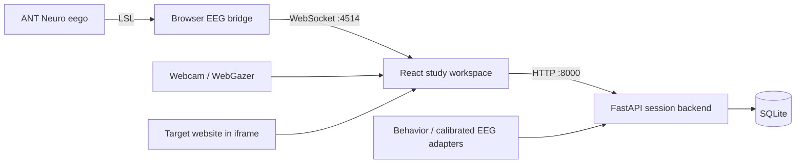

<div align="center">

# FrictionFix

### Find the moments where users get stuck.

EEG signals, webcam eye tracking, and browser behavior for evidence-driven usability research.

**[Open the live demo](https://frictionfix.netlify.app/)** · [Run locally](#run-locally) · [Backend API](backend/INTEGRATION.md) · [Contribute](CONTRIBUTING.md)


</div>

FrictionFix helps researchers connect **where someone looks**, **how they interact**, and **changes in EEG activity** while exploring a website. The React app brings signal setup, an embedded study view, gaze visualization, and session results into one workspace. The Python backend aggregates observations into friction events with a transparent evidence breakdown.

Built as a hackathon prototype, with optional hardware integration and a backend that can also run without an EEG headset.

## Explore the demo

Visit **[frictionfix.netlify.app](https://frictionfix.netlify.app/)** to explore the interface.

The hosted site serves the frontend. Backend session storage and live EEG require the local services below. Eye tracking needs webcam permission and calibration. Without a live EEG connection, the study view uses simulated load values for demonstration.

## What’s inside

| Component | Capabilities |
| --- | --- |
| Study workspace | Load a target URL, run a timed session, and review results. |
| Webcam eye tracking | WebGazer calibration, gaze heatmap, and fixation observations. |
| Live EEG display | ANT Neuro eego → Lab Streaming Layer (LSL) → local WebSocket bridge. |
| Friction engine | Combine gaze dwell, browser behavior, and optional calibrated EEG evidence into scored episodes. |
| Session API | Validated event ingestion, calibration, SQLite persistence, and JSON export. |
| Optional AI suggestions | Browser-side Anthropic integration and a separate backend Gemini/Vertex AI integration. |

The current UI creates `manual` / `behavior_only` backend sessions and forwards gaze observations. The backend also supports richer browser-event ingestion and calibrated EEG through its API; those capabilities require a client or adapter to send the corresponding data. See the [integration contract](backend/INTEGRATION.md).

## How it fits together



There are two EEG bridges: [`bridge.py`](bridge.py) streams a load display to the browser; [`backend/frictionfix/bridge.py`](backend/frictionfix/bridge.py) sends live or replayed EEG samples to the backend for quality checks, feature extraction, and calibration. They serve different workflows.

## Run locally

### 1. Start the frontend

Use Node.js 22 and npm, then:

```bash
git clone https://github.com/louislndr/novahackathoneeg.git
cd novahackathoneeg
npm ci
npm run dev
```

Open the URL printed by Vite, normally **http://localhost:5173**. You can explore the interface without starting the Python services.

### 2. Start the session backend

In another terminal, from the repository root, use **Python 3.11+**:

```bash
cd backend
python3 -m venv .venv
source .venv/bin/activate
python -m pip install -e '.[test]'
python -m uvicorn frictionfix.app:app --host 127.0.0.1 --port 8000
```

For Windows commands, see the [backend setup guide](backend/README.md#start-on-windows-powershell).

- Interactive API: **http://127.0.0.1:8000/docs**
- Health check: **http://127.0.0.1:8000/health**
- Default storage: `backend/data/sessions.sqlite3` (ignored by Git)

The frontend currently connects to `http://127.0.0.1:8000` and `ws://localhost:4514`. Run the app and services on the same computer. Keep the backend to one worker and avoid restarting it during recordings.

### 3. Connect live EEG (optional)

For the browser’s live load display, activate the Python environment above and run these commands from the repository root:

```bash
python -m pip install pylsl websockets numpy
python bridge.py
```

Start recording in ANT Neuro eego and enable **Extras → LSL → Start**. The bridge looks for an EEG stream on the local network. To specify the eego computer directly:

```bash
python bridge.py --eeg-host 192.168.1.42
```

Enable **Live EEG** in **Signal Setup**. Both machines need network access to each other; `pylsl` may also require a platform-specific liblsl installation.

For backend EEG replay, participant calibration, or the backend LSL adapter, follow the [backend guide](backend/README.md).

## Run a study

1. Open **Signal Setup** and enable the signals you want to use.
2. If using eye tracking, allow webcam access and complete the nine-point calibration.
3. Enter a website URL in the study view and start a session.
4. Browse the target site while the workspace displays gaze and load information.
5. End the session to review the results.

Some websites block embedding through `X-Frame-Options` or Content Security Policy. Cross-origin iframes also restrict access to page elements, so exact element attribution requires a compatible same-origin page or a cooperating integration.

## Interpreting results

The backend groups qualifying evidence for the same page and element into episodes, then scores each episode by summing fixed weights for distinct evidence types. Repeated occurrences of the same evidence type within an episode do not keep increasing the score.

Scores describe the evidence collected; **they are not probabilities that a user is confused**. The browser’s heuristic load display and the backend’s participant-calibrated EEG model are separate. The UI does not currently send its live load display into the backend’s calibrated EEG pipeline.

See [validation results and known limitations](backend/VALIDATION.md) for the development checks, replay experiments, and outstanding hardware validation.

## Repository guide

```text
.
├── src/                    React app, screens, gaze tracker, and API client
├── public/mediapipe/        Vendored Face Mesh assets used by eye tracking
├── backend/                FastAPI service, EEG pipeline, examples, and tests
├── bridge.py               LSL → browser WebSocket bridge
├── docs/                   Hackathon reference material
├── tasks/                  Development notes and task history
└── .github/workflows/      Frontend build and backend test checks
```

| Guide | Contents |
| --- | --- |
| [Contributing](CONTRIBUTING.md) | Development workflow and verification commands |
| [Backend README](backend/README.md) | Setup, scoring, EEG calibration, and optional AI configuration |
| [Frontend integration](backend/INTEGRATION.md) | API contract, event types, timestamps, and examples |
| [Validation](backend/VALIDATION.md) | Tested behavior, evaluation results, and limitations |
| [AI usage](backend/AI_USAGE.md) | Implementation assistance and algorithm rationale |
| [Challenge handout](docs/challenge-handout.pdf) | Original hackathon brief |

## Build and verify

```bash
# From the repository root
npm run build
npm run preview

# With the backend virtual environment activated
cd backend
python -m pytest -q
```

The frontend build writes to `dist/`. The backend tests use synthetic signals and mocked AI services; they do not require a headset, webcam, or cloud credentials.
